# 明珠轩辕脚本 傻瓜式教程

> 面向**第一次用**的人：从零装到配置完成，照着图做，不要跳步。
> 遇到没写的细节，先看 [安装与使用](installation.md)；本文只讲「照着点就能跑」的路径。
> 最后更新：2026-11-01（对应 `dev` 分支，配图来自真实安装过程）

## 准备工作

开始之前，确认你有这四样东西：

1. **一台 Windows 电脑**（Win10 / Win11 64 位），有独立显卡更稳。
2. **一个安卓模拟器**。推荐 **MuMu 模拟器 12**（脚本支持它的后台截图，最省资源）；雷电、夜神也能用，但后台截图要另配。
3. **两个压缩包**（都免费，见第 1 步）：
   - **前端** [mzxyOASX](https://github.com/jiaysr/mzxyOASX)：控制台，负责启动 / 停止 / 看日志；
   - **脚本本体** [mzxyAutoScript](https://github.com/jiaysr/mzxyAutoScript)：真正干活的那个。
4. **一个心态**：出问题先看日志，不要先怀疑人生。90% 的问题日志里都写着。

> 本项目**永久免费**。如果你在任何渠道付了钱，请去退款。

## 0. 网络环境

脚本本体要能从 GitHub 拉更新、能装 Python 依赖。

1. 能正常打开 GitHub → **这一节直接跳过**，去做第 1 步。
2. 打不开 GitHub → 用发行包（Releases 的压缩包，不需要 git 也能装），并在脚本目录的 `config/deploy.yaml` 里配代理：
   ```yaml
   GitProxy: http://127.0.0.1:7897 # 换成你自己的代理端口，没有就保持 null
   ```
3. 装依赖慢或失败 → 把 `PypiMirror` 设成国内镜像（发行包里默认已经是清华源）：
   ```yaml
   PypiMirror: https://pypi.tuna.tsinghua.edu.cn/simple
   ```
4. 不要用来源不明的「一键加速器」——本项目不需要，装了反而容易把 ADB 弄乱。

## 1. 下载与解压

### 1.1 下载脚本本体

1. 打开 [mzxyAutoScript 仓库](https://github.com/jiaysr/mzxyAutoScript)。
2. 点右侧的 **Releases**（红箭头位置）。

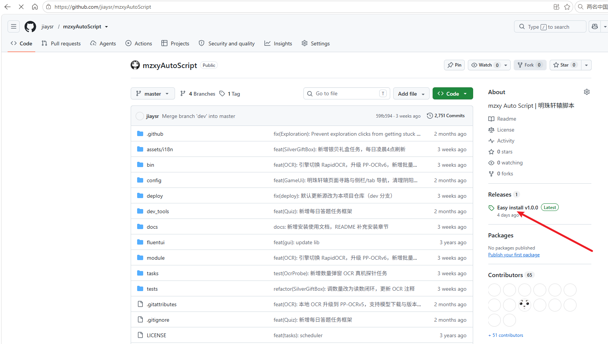

_图 1：仓库首页 → 右侧 Releases_

3. 在 **Easy install** 这条 Release 里点 **`mzxyAutoScript-easy-install.rar`** 下载。
   > ⚠️ **不要点 “Source code (zip)”**，那只是源码，里面没有 Python 环境和 OCR 模型，装不起来。

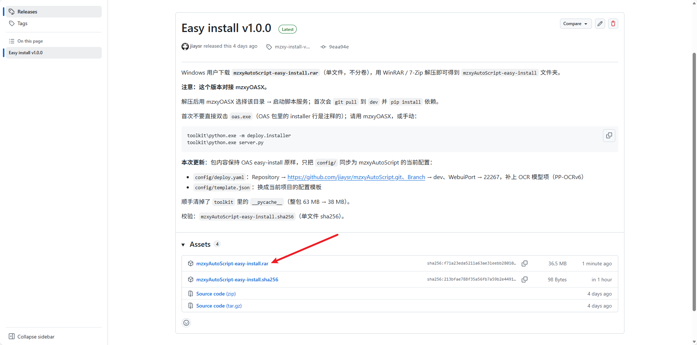

_图 2：下载 `mzxyAutoScript-easy-install.rar`（单文件，不分卷）_

### 1.2 解压脚本本体

用 WinRAR / 7-Zip 解压，**目标路径填 `E:\MC\mzxyAS`**（盘符随意，路径不要有中文和空格）。

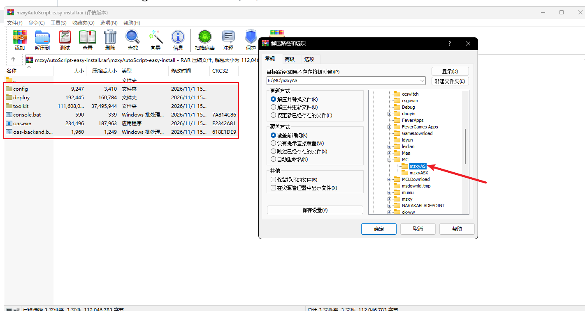

_图 3：解压到 `E:\MC\mzxyAS`_

### 1.3 下载并解压前端

1. 打开 [mzxyOASX 仓库](https://github.com/jiaysr/mzxyOASX)，同样点右侧 **Releases**。

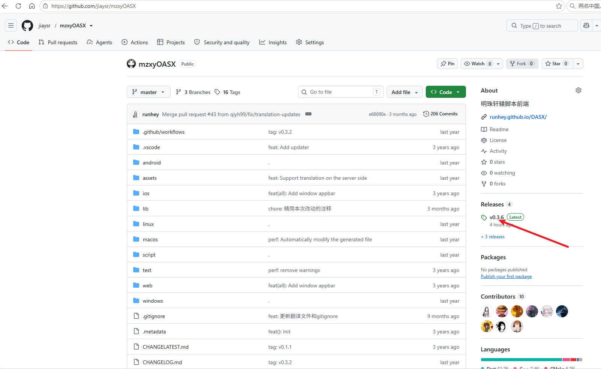

_图 4：mzxyOASX 仓库 → Releases_

2. 下载 **`oasx_版本号_windows.zip`**（本文写作时是 `oasx_0.3.6_windows.zip`）。

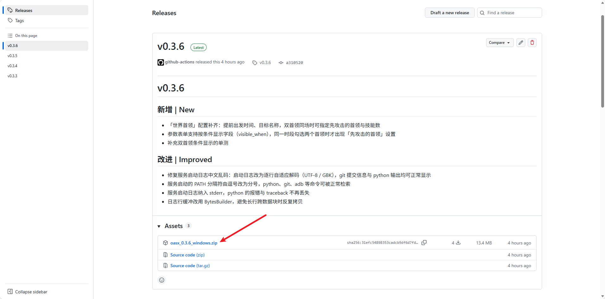

_图 5：下载 `oasx_x.x.x_windows.zip`_

3. 解压到 **`E:\MC\mzxyASX`**。

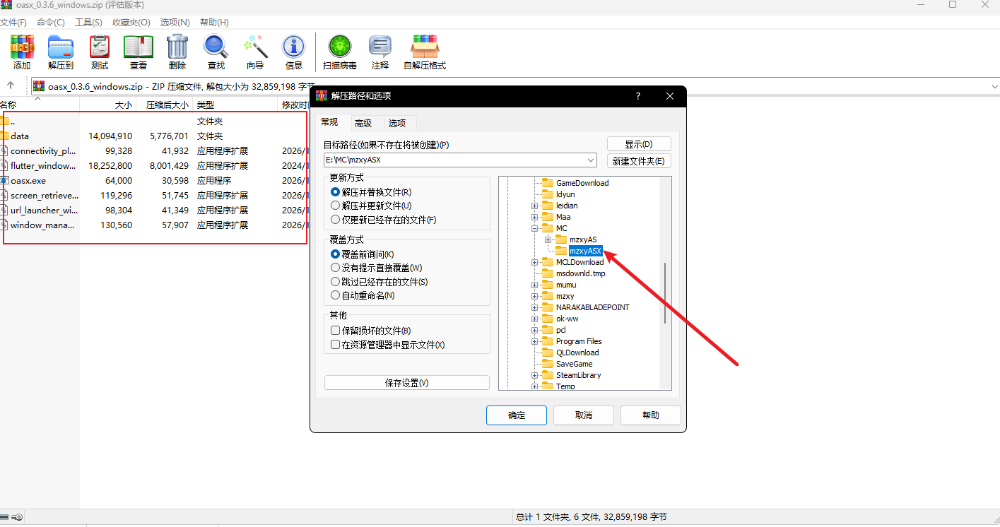

_图 6：解压到 `E:\MC\mzxyASX`_

最终这两个文件夹要**并排放在同一个父目录**里，且**不能互相嵌套**：

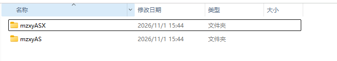

_图 7：`mzxyAS`（脚本）和 `mzxyASX`（前端）是两份东西，不要解压到同一个目录_

| 目录            | 里面有什么                                                 |
| --------------- | ---------------------------------------------------------- |
| `E:\MC\mzxyAS`  | `config/`、`deploy/`、`toolkit/`、`oas.exe`、`console.bat` |
| `E:\MC\mzxyASX` | `oasx.exe`、`data/`、一堆 `*.dll`                          |

> 脚本目录**完全便携**：整个目录复制到别的电脑也能用，不想要了直接删目录就是卸载。

## 2. 启动脚本服务（用前端）

### 2.1 运行前端

进 `E:\MC\mzxyASX`，双击 **`oasx.exe`**。

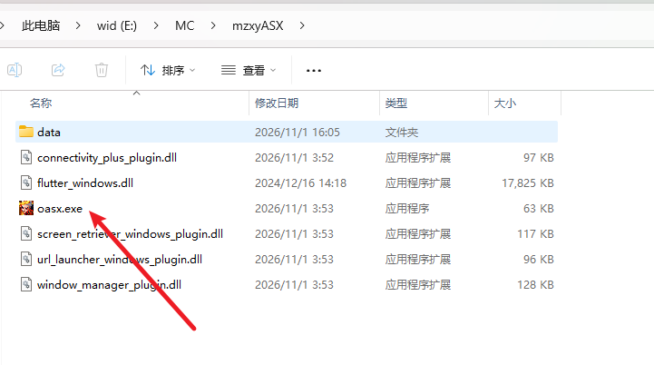

_图 8：双击 `oasx.exe` 启动前端_

第一次运行会被 Windows 拦一下，点 **「仍要运行」** 即可（这是 SmartScreen 对未知发行者的常规提示，不是报错）。

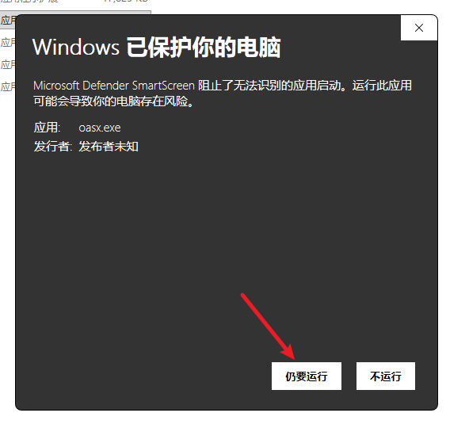

_图 9：点「仍要运行」_

### 2.2 进入服务页

前端打开后是登录页。**Username / Password 留空**，先点**右下角的紫色圆按钮**进「服务」页。

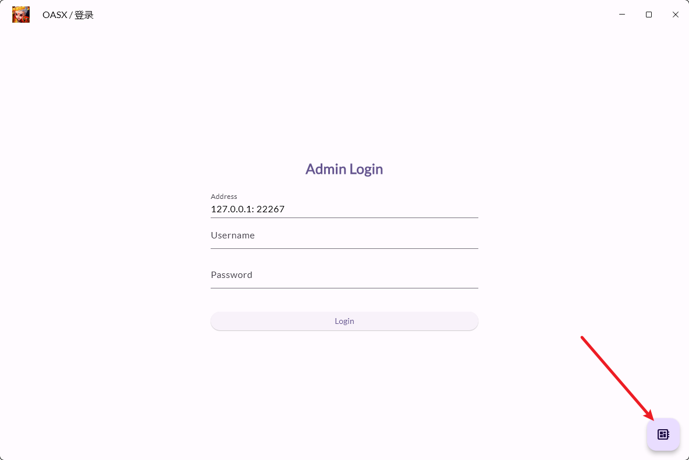

_图 10：先点右下角按钮，进 Server 页_

### 2.3 选择 OAS 根目录

在「Server」页点 **「选择文件夹」**，选中第 1 步解压出来的 **`mzxyAS`**。

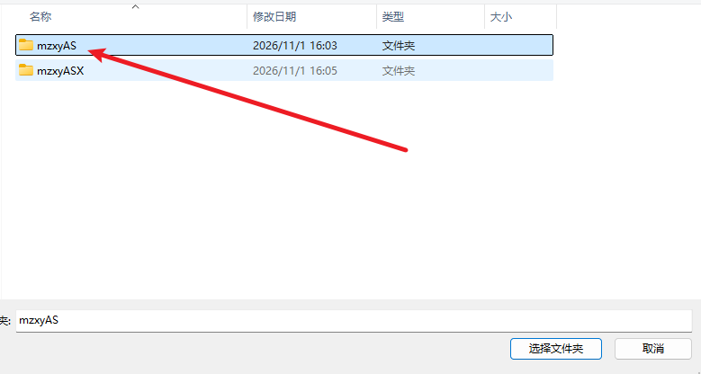

_图 11：选中 `mzxyAS`（脚本目录），不是 `mzxyASX`_

> 如果顶部显示红字「**无法识别的根目录，你可能没有正确安装 OAS**」，就是选错目录了
> （常见是选了 `mzxyASX` 或它们的父目录）。重新点「选择文件夹」，选到 `mzxyAS` 为止。

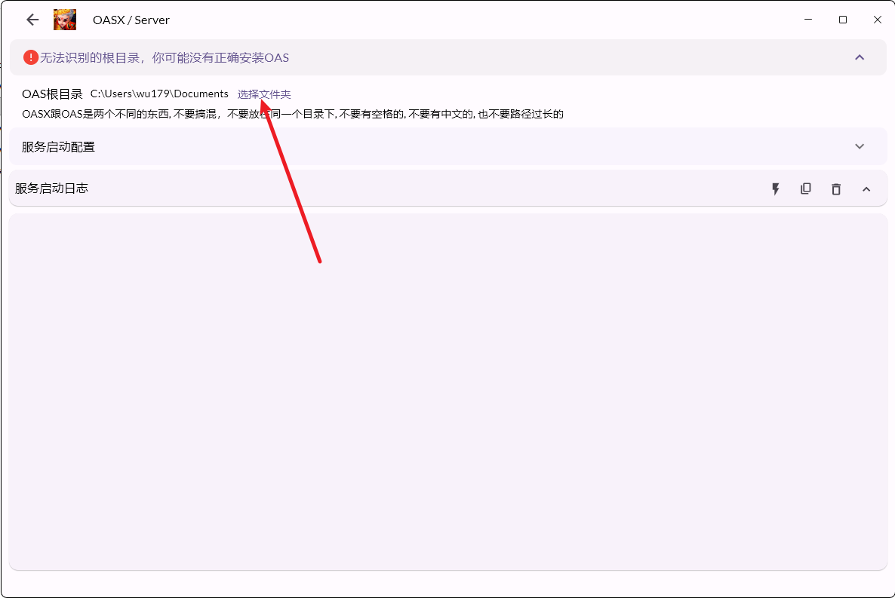

_图 12：选错目录时的提示_

选对之后会变成绿字「**正确识别为 OAS 的根目录**」，路径显示 `E:\MC\mzxyAS`。

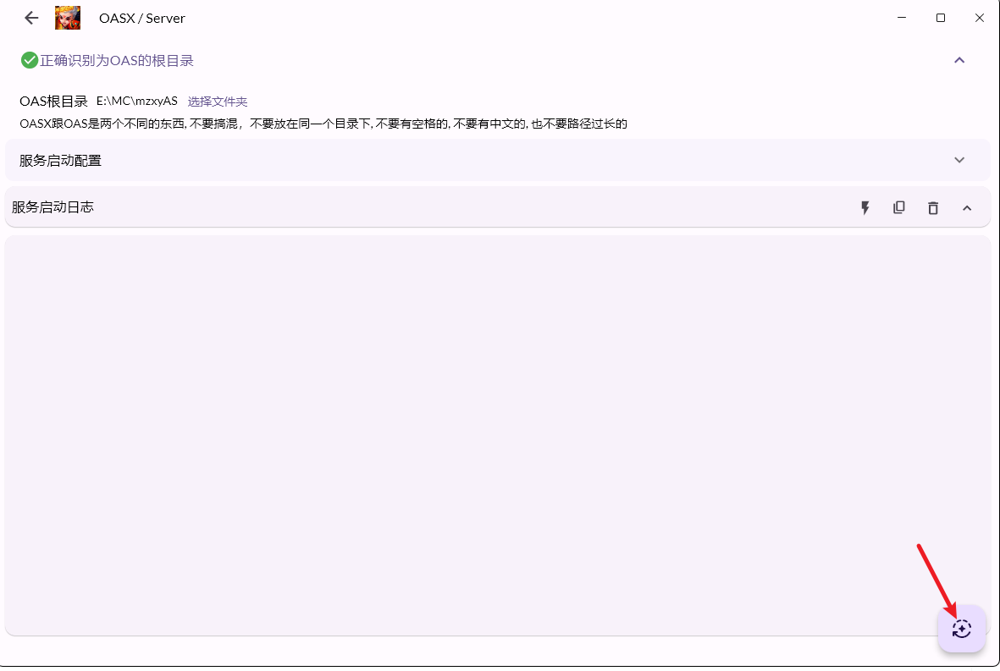

_图 13：绿勾 = 目录选对了_

### 2.4 启动服务

点右下角的**紫色圆按钮**开始启动。首次启动会做三件事：`git pull` 到 `dev` 分支 → `pip install` 依赖 → 起 Web 服务，
**大约 2~5 分钟**，日志会一直滚，属正常现象。

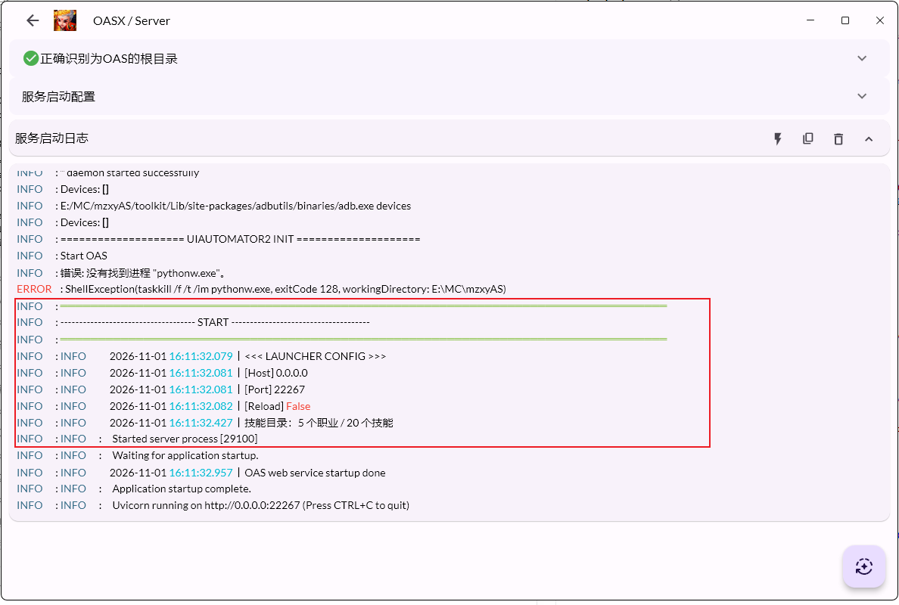

_图 14：红框里出现 `[Port] 22267` 和 `OAS web service startup done` 就是启动成功_

启动成功的标志（日志里这一段）：

```
<<< LAUNCHER CONFIG >>>
[Host] 0.0.0.0
[Port] 22267
OAS web service startup done
Uvicorn running on http://0.0.0.0:22267
```

**记住 `[Port]` 后面的数字**，下一步登录要用。

> 日志里如果有 `错误: 没有找到进程 "pythonw.exe"`，那是启动前清理旧进程的提示，可以忽略。

### 2.5 登录

回到登录页，在 **Address** 里填 `127.0.0.1:端口`（默认 `127.0.0.1:22267`），
Username / Password **留空**，点 **Login**。

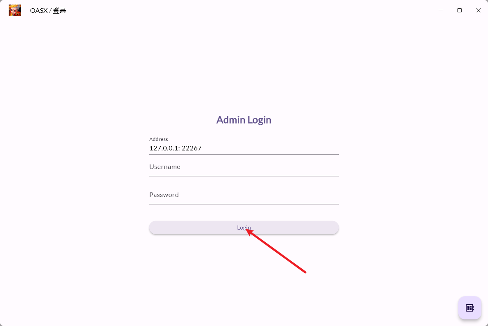

_图 15：Address 填 `127.0.0.1:22267` → Login_

- 前端和脚本在**同一台电脑**：`127.0.0.1:22267`
- 不在同一台：`脚本机的局域网IP:22267`（如 `192.168.1.10:22267`）
- 也可以直接在浏览器打开 `http://127.0.0.1:22267`，效果一样。

登录进去就说明脚本服务已经在跑了。以后开关脚本都在前端的「服务」页点，不用再碰命令行。

> **关于 `config/deploy.yaml`**：发行包里已经配好（仓库、`dev` 分支、端口 22267）。
> 只有**端口被占用**或**要换仓库**时才需要手动改它，改完重启一次服务即可。

## 3. 设置模拟器（以 MuMu 12 为例）

**有三项必须严格照做**，其余随意：

| 必须设置 | 怎么设                              | 为什么                                                           |
| -------- | ----------------------------------- | ---------------------------------------------------------------- |
| 显卡渲染 | **Vulkan**（不要选 DirectX / 自动） | 脚本只在 Vulkan 下调试过，其它模式不在支持范围                   |
| 分辨率   | **1280x720**，横屏                  | 所有点击坐标、找图区域都按 1280x720 横屏标定，换分辨率必挂       |
| 应用保活 | **关闭**                            | 开着保活，脚本「关游戏省资源」会关不掉，任务结束后游戏还在占内存 |

具体操作：

1. **装好 MuMu 12**，创建一个安卓实例。
2. 打开模拟器右上角 **设置 → 性能**：显卡渲染选 **Vulkan**；CPU 4 核、内存 4G 起步（够用就行，不是硬要求）。
3. **设置 → 显示**：分辨率选 **`1280x720`**，方向 **横屏**。
4. **设置 → 其他**：
   - **关闭「应用保活」**；
   - 打开「ADB 调试 / 本地连接」；
   - 记下 **ADB 端口**（默认 `16384`），后面填设备要用。
5. **把游戏装进模拟器**，登录一次，进到**主界面**再退出登录界面（别停在登录页）。
   （模拟器路径先不用记，第 4 节填配置时按图 17 取一次就行。）

> 性能（核数/内存）、机型、网络模式这些**没有要求**，按你电脑的配置来就行。

## 4. 脚本设置（第一次必看）

登录前端后进「脚本设置」，**照着下表填**（这几项不要留 auto）：

| 项                          | 填什么                                                                          |
| --------------------------- | ------------------------------------------------------------------------------- |
| 设备（Serial）              | `127.0.0.1:16384`（MuMu 默认 ADB 端口，就是第 3 节第 4 条记下的那个）           |
| 句柄                        | **不填**，留空                                                                  |
| 包名                        | **小七版** 选 `pip.com.xuanyuan.x7sy`；**官方版** 选 `com.pip.android.xuanyuan` |
| 模拟器截屏方案              | **`nemu_ipc`**（MuMu 后台截图，窗口最小化也能跑）                               |
| 模拟器控制方案              | **`minitouch`**                                                                 |
| 模拟器类型                  | `MuMuPlayer12`                                                                  |
| 模拟器路径                  | 按下面的图取，粘贴进来                                                          |
| 模拟器静默启动 / 纯后台运行 | 可选：想让它悄悄跑就勾上                                                        |

**模拟器路径怎么取**（图 17）：

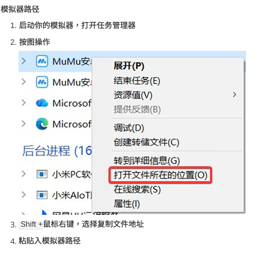

_图 17：任务管理器 → 右键 MuMu 进程 → 打开文件所在的位置 → Shift+右键 → 复制文件地址_

1. 先启动模拟器，打开 **任务管理器**；
2. 找到 MuMu 进程 → 右键 → **打开文件所在的位置**；
3. 在打开的文件夹里 **Shift + 鼠标右键** → 选 **「复制文件地址」**；
4. 粘贴到「模拟器路径」里（形如 `D:\Program Files\MuMuPlayer-12.0\shell`），首尾的引号去掉。

## 5. 游戏内设置

脚本靠**看图 + OCR** 干活，游戏里的界面设置必须和下面一致（下图红框部分），否则识别会出错：

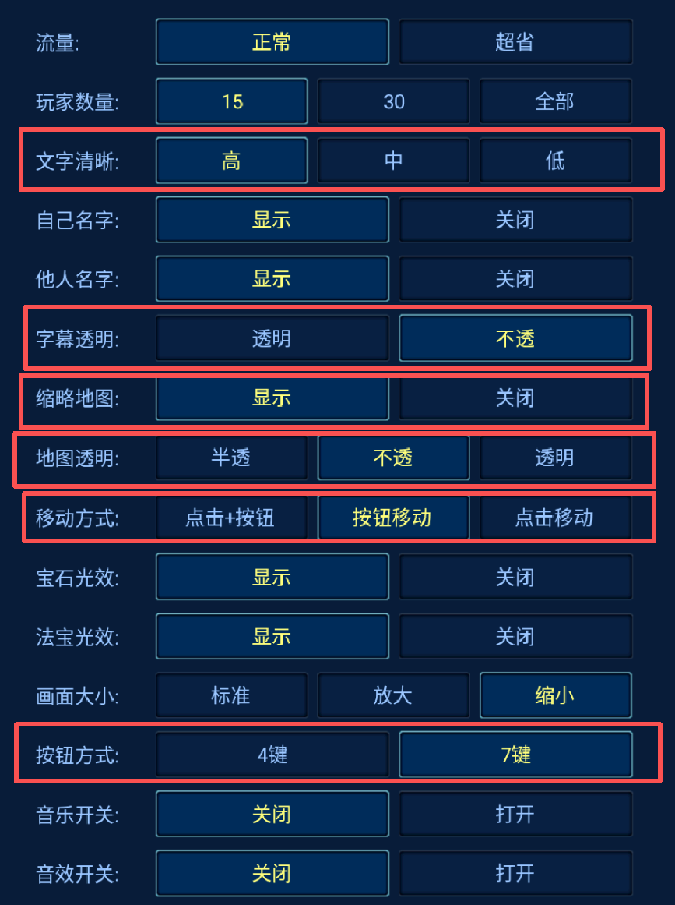

_图 16：红框里的 6 项必须一致，其余项随意_

| 设置项       | 必须选       | 作用                                       |
| ------------ | ------------ | ------------------------------------------ |
| **文字清晰** | **高**       | OCR 读题干、任务名、次数，字体糊了就读错   |
| **字幕透明** | **不透**     | 半透明文字和背景混在一起，OCR 容易漏字     |
| **缩略地图** | **显示**     | 脚本靠小地图点 NPC、点传送点               |
| **地图透明** | **不透**     | 透明地图会让地图识别找不到特征             |
| **移动方式** | **按钮移动** | 脚本按固定位置拖摇杆走位，其它模式下走不动 |
| **按钮方式** | **7 键**     | 战斗固定点 7 个技能位，4 键会点空          |

其余项（流量、玩家数量、自己/他人名字、宝石光效、法宝光效、画面大小、音乐音效）**不影响脚本**，按自己习惯设就行；想省事可以直接照抄图里这套。
